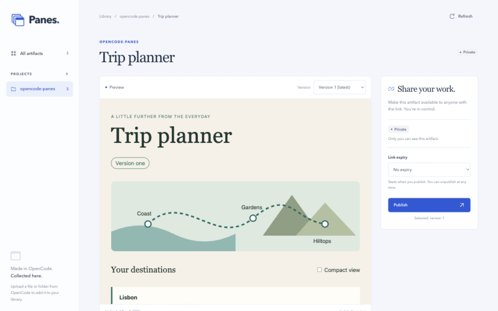

# OpenCode Panes

**Make anything locally. Upload it privately. Share it when you are ready.**

Panes is an open-source **OpenCode plugin** with a self-hosted visual library on
Cloudflare. Ask OpenCode to upload an HTML page, SVG, or browser-ready prototype;
review its versions in your private dashboard; and publish a share link only when
you choose. Each deployment has one owner. Collaborators view the links you
share; they do not get access to your dashboard.



_The owner dashboard previewing a test artifact uploaded from a local session._

**Try it:** Panes has no shared hosted account. [Host your own library](docs/OPERATIONS.md),
then [install the plugin](#install-the-plugin).

## What you can do

- **Upload without ceremony.** Select an ordinary file or folder in your project.
  Panes uploads a private snapshot; it never moves your source, creates local
  revision directories, or changes Git.
- **Review every version privately.** Browse by project, search, filter by sharing
  status, and preview any uploaded version in an isolated sandbox.
- **Share exactly one version.** Publish the version you choose, with no expiry
  or a 1-, 7-, or 30-day link. New uploads never change what collaborators see
  until you click **Update shared version**. **Unpublish** stops access immediately.

## Everyday use

Once the plugin and your deployment are configured, work through OpenCode in
plain language. You do not need to call the tools yourself.

**Create and upload**

> Create a checkout prototype in `mockups/checkout/` with an HTML entry and
> relative CSS and JavaScript assets. Then upload that folder to Panes, titled
> Checkout prototype. Keep it private and give me its dashboard link.

Select a file for a self-contained HTML or SVG, or select the whole folder when
the entry depends on neighboring assets. Sources must be inside the current
project. Folder entries default to `index.html`. Panes asks permission to upload;
it never builds a framework project or publishes on your behalf.

**Find and review your work**

> Give me the link to my Panes dashboard.

Click an artifact's card to open the preview; the version selector shows earlier
uploads. Your dashboard link is for you; it is not the link to send to collaborators.

**Share a version**

In the dashboard, choose the version, choose **No expiry** or a duration, click
**Publish**, and confirm. Use **Copy link** or **Open** on the resulting share.
Anyone holding that link can view the selected version and access its uploaded
files, without your owner login.

**Revise without changing the shared version**

> Update `mockups/checkout/` to add an order summary. Upload the same folder
> again with the same title. Do not change the shared version.

Keep the same project, source path, title, and project-name override throughout
the workflow. A new snapshot creates another cloud version. Uploading an identical
snapshot again, including its metadata, reuses its original cloud version instead
of creating a duplicate. Moving the source to a different path identifies a
different artifact.

Interrupted uploads can resume for **seven days from the upload's creation**.
File retries do not extend that window. After it closes, ask to upload again:
the same snapshot automatically gets a fresh upload session on the same artifact.
Unfinished uploads never consume version numbers. Completed versions, whether
private or shared, do not expire as part of upload housekeeping.

After reviewing the new version, click **Update shared version** and confirm to
update the active link without changing its URL. A card labeled
**Latest v2 / Shared v1** means the latest upload is not yet the one
collaborators see. Updating with a finite duration restarts that duration at
confirmation; the confirmation also makes an explicit switch to no expiry visible.

**Stop sharing or remove an artifact**

- **Unpublish** disables the current link and keeps all cloud versions private.
- Publishing again after unpublish creates a new link; the old one stays invalid.
- **Delete artifact** removes the cloud artifact and all its uploaded versions,
  with a separate confirmation. It does not delete your local files.

For a step-by-step trial with copy-ready prompts and expected results, use the
[manual test guide](docs/manual-testing.md).

## Install the plugin

You need your own Panes deployment first; see [operations](docs/OPERATIONS.md).
The plugin targets the OpenCode 2 plugin API (OpenCode 2.0.18 or newer).
Then, with Node.js 22.12 or newer and npm 11:

```sh
npm install
npm run install:plugin
```

The installer builds one standalone `opencode-panes.js` file and installs it
under your OpenCode plugin directory. It does not change OpenCode configuration
or install a skill. Set these environment variables when starting OpenCode:

| Variable                    | Value                                                |
| --------------------------- | ---------------------------------------------------- |
| `OPENCODE_PANES_API_URL`    | Your Panes deployment's HTTPS origin                 |
| `OPENCODE_PANES_UPLOAD_KEY` | The secret matching your Worker's `PANES_UPLOAD_KEY` |

Keep the upload key in your shell's secret management, not a repository or a URL.
Quit and restart OpenCode after installing the plugin or changing its environment.
To reference a protected secret file from OpenCode configuration instead, see
[plugin configuration](docs/OPERATIONS.md#plugin-configuration).

The plugin exposes two tools:

- `artifact_upload`: upload a selected local file or browser-ready folder privately.
- `artifact_dashboard`: return the authenticated library URL; it does not open
  a browser itself.

There is no plugin tool that publishes content; sharing happens only in the dashboard.

## How it works

```text
OpenCode ──artifact_upload (machine upload key)──▶ Worker ──▶ R2 (private files)
                                                     │  └──▶ D1 (projects, versions, shares)
Owner ──Cloudflare Access──▶ dashboard ──Publish──▶ share link /s/… ──▶ collaborators
```

A Cloudflare Worker serves the dashboard and HTTP interface, D1 stores
project/version/share metadata, and one private R2 bucket holds artifact files.
Every file request goes through Worker authorization. Owner login (Cloudflare
Access), machine uploads, short-lived private previews, and public share links use
separate credentials, and artifact code never receives any of them. Previews run
in sandboxed frames without same-origin privileges. See the
[security model](docs/security-model.md) for details.

## Supported content and limits

- HTML and SVG files.
- Browser-ready folders containing HTML, CSS, JavaScript, images, fonts, and assets.
- Locally built output from React or other frontend frameworks.

Framework source must be built locally before upload. Panes does not compile
React source, render Markdown or Mermaid source, install packages, execute code
on the server, or host application backends. HTTPS resources are allowed in
previews; ordinary browser CORS and sandbox restrictions still apply. Use
relative asset URLs so files resolve within the uploaded version.

An upload supports up to 500 files, 25 MiB per file and 100 MiB total. Panes
preserves raw bytes and excludes environment files, common private-key files,
Git internals, dependencies, and caches. Exclusions are not a secret scanner:
**only select content you intend to upload, and never embed secrets in a
browser artifact.** Anyone with a share link can access that version's uploaded
files, not only its rendered preview. Panes does not apply `.panesignore` or
`.gitignore` rules; select a dedicated artifact or build-output folder instead.

Unpublishing or deleting cannot erase copies someone has already downloaded or
content already loaded in their browser. Test revocation by making a fresh request.

## Local development

```sh
npm install
npm run format
npm run typecheck
npm test
npm run build
npm run smoke:plugin
```

These check formatting, types, and the Worker, dashboard, and plugin tests, then
build both packages and load the standalone plugin bundle outside the repository.
Local Worker setup, the end-to-end acceptance test, and the sandbox form
regression are described in [development and verification](docs/DEVELOPMENT.md).

## Documentation

- [Operations](docs/OPERATIONS.md): self-hosting, Access, secrets, migrations, and plugin configuration.
- [Security model](docs/security-model.md): credentials, sandboxing, and sharing boundaries.
- [Development and verification](docs/DEVELOPMENT.md): local Worker, acceptance, and browser checks.
- [Manual test guide](docs/manual-testing.md): copy-ready prompts and expected results.
- [HTTP interface](docs/simple-library-interface.md) and [storage cleanup](docs/storage-cleanup.md).
- [Upgrading from v0.1/v0.2](docs/upgrading-from-v0.2.md): what changed and what is no longer supported.
- Releases: [v0.3](docs/releases/v0.3.md), [v0.3.1](docs/releases/v0.3.1.md),
  and [v0.4](docs/releases/v0.4.md).
- [`CONTEXT.md`](CONTEXT.md) for product vocabulary and [`PROJECT_PLAN.md`](PROJECT_PLAN.md) for accepted scope.

## License

[MIT](LICENSE)
